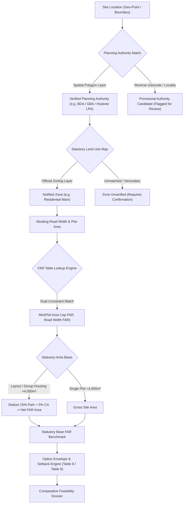
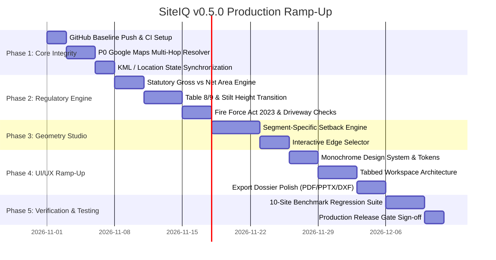

# SiteIQ — Comprehensive Master Implementation Plan (v2.0)
## Architectural Reliability, Regulatory Compliance & Minimalist UI Ramp-up

**Document ID:** `SITEIQ-MIP-2026-V2`  
**Baseline Codebase:** SiteIQ v0.4.7 (`SiteIQ_v047_GoogleMapsPriorityFix`)  
**Target Repository:** `https://github.com/Pritish3110/SiteIQ.git`  
**Domain Scope:** Automated Early-Stage Architectural Feasibility, Statutory Building Controls & Zoning Analysis  
**Primary Focus Jurisdiction:** Karnataka, India (Expanding to Multi-State Architecture)

---

## Executive Summary & System Audit

SiteIQ addresses one of the most error-prone and labor-intensive phases of architectural practice: **preliminary zoning, land-use feasibility, and maximum development yield calculations**. In real-world property development, feasibility numbers directly dictate land valuation, investor financing, developer underwriting, and municipal sanction viability. 

### The Real-World Impact & Liability Stakes
Feasibility reports in Indian urban development are high-liability documents:
1. **Misinterpreting Gross vs. Net Site Area:** For sites exceeding 4,000 m² or group housing layouts, statutory open space (15%) and civic amenity (5%) reservations reduce the FAR calculation denominator. Calculating FAR on gross site area overstates saleable square footage by 15–20%, creating multi-crore financing shortfalls.
2. **Applying Wrong Planning Authority Regulations:** Bengaluru RMP 2015 rules are frequently misapplied to satellite towns (Hoskote, Kanakapura, Nelamangala, Anekal, Doddaballapura) which possess distinct Local Planning Area (LPA) master plans with differing road-width thresholds and lower base FAR caps.
3. **Flawed Setback & Height Envelopes:** Confusing Table 8 percentage setbacks with Table 9 height-based setbacks, ignoring fire tender driveway clearances (minimum 6.0 m clear path for buildings ≥21 m under the Karnataka Fire Force Act 2023), or miscalculating basement setbacks can lead to non-sanctionable floor plates and demolition notices.
4. **Outdated Government Notifications:** Applying draft uniform zonal regulations (e.g., UDD 559 BMR 2025(E)) that have not legally commenced, or missing high court stays, erodes client trust and exposes architects to professional negligence claims.

### System Audit of Codebase Baseline (v0.4.7)
* **Core Strengths:** Pure Python engine decoupling in `siteiq/engine.py` (no Streamlit dependency), robust Shapely geometric validation in `siteiq/boundary.py`, clean separation of ReportLab/python-pptx generators in `siteiq/exporters.py`, and a 75-test regression suite.
* **Critical Vulnerabilities:**
  - *UI Clutter:* Single-page vertical scroll in `app.py` dumping 5 sequential workflows, 30+ form controls, raw JSON payloads, and duplicate previews into one overwhelming interface.
  - *Location Precedence Fragility:* Google Maps short URLs (`maps.app.goo.gl`) fail closed inconsistently when facing multi-hop redirects or Google consent prompts, occasionally risking stale coordinate drift.
  - *Geometry Approximation:* Variable setbacks on irregular polygons currently use an empirical edge-band subtraction algorithm (`_edge_band()`) rather than exact geometric half-plane or straight-skeleton offsets.
  - *Provisional Rules Exposure:* Secondary-source LPA profiles (Hoskote, Kanakapura) lack automated cross-verification against authoritative Gazette notifications and official zoning shapefiles.

---

## 1. Repository Setup & Version Control Deployment

The codebase has been initialized, checked against strict `.gitignore` rules, and prepared for synchronization with `https://github.com/Pritish3110/SiteIQ.git`.

### 1.1 Local Repository Status
1. **Git Initialization:** Empty Git repository initialized in `SiteIQ_MVP_v0.4.7_GoogleMapsPriorityFix`.
2. **Exclusion Hardening:** Comprehensive `.gitignore` implemented to strictly exclude virtual environments (`.venv/`), Python bytecache (`__pycache__/`, `*.pyc`), test artifacts (`.pytest_cache/`), geocoding caches (`data/geocode_cache/`), temporary uploads, and local secrets.
3. **Initial Commit:** Staged 54 project files (16,121 insertions) with message `"Initial SiteIQ codebase import"`.
4. **Branch & Remote:** Set branch to `main` and linked remote `origin` to `https://github.com/Pritish3110/SiteIQ.git`.

### 1.2 Push Execution Guidance
GitHub HTTPS pushes require authentication via Git Credential Manager (GCM), browser SSO, or a GitHub Personal Access Token (PAT):
```bash
# In the terminal / command prompt:
cd "C:\Users\Lenovo\Downloads\SiteIQ_v047_GoogleMapsPriorityFix\SiteIQ_MVP_v0.4.7_GoogleMapsPriorityFix"
git push -u origin main
```
*Note:* If prompted by Windows Git Credential Manager, complete the browser login prompt once, or use a GitHub Personal Access Token (PAT) with `repo` scope.

---

## 2. Regulatory Engine Reliability & State-Level Legal Gaps

To ensure absolute reliability and prevent financial or legal loss for developers, the calculation engine must mirror the strict hierarchy of Indian town planning laws.



### 2.1 Jurisdictional Segregation (KTCP Act 1961 vs. Municipal Corporations)
* **The Planning Authority vs. Municipal Corporation Trap:** In Karnataka, the Local Planning Authority (LPA) or Development Authority (BDA, GBA, BMRDA, MUDA, KUDA) is empowered under the Karnataka Town and Country Planning Act, 1961 to prepare Master Plans and declare Zonal Regulations. Municipal Corporations (BBMP, City Corporations) are licensing bodies under Municipal Corporation Acts. They are **not** interchangeable.
* **Multi-Tier Boundary Validation:**
  - *Tier 1 (Authoritative):* Point-in-polygon containment against official notified LPA boundary layers.
  - *Tier 2 (Provisional Warning):* If derived from reverse geocoding (Nominatim), the engine must prominently display a `PROVISIONAL JURISDICTION CANDIDATE` alert and prevent treating the candidate as statutory entitlement.
  - *Boundary Overlap Diagnostics:* Parcels situated within 500 metres of an LPA boundary must trigger a multi-jurisdiction overlap flag, as satellite towns frequently border Gram Panchayats or adjacent LPAs.

### 2.2 Core FAR Logic & Calculation Precision
* **Dual-Constraint Table Matching:** In Bengaluru RMP 2015 (Table 10 for Residential Main) and corresponding LPA tables, FAR is governed by two simultaneous parameters: Plot Area and Abutting Road Width. The engine must compute:
  $$\text{Base FAR} = \min\big(\text{FAR}_{\text{plot\_area\_cap}}, \text{FAR}_{\text{road\_width}}\big)$$
  *Zero Interpolation Policy:* No interpolation or rounding between table bands is legally permissible. If a plot area is 999.9 m², it falls into the `< 1,000 \text{ m}^2` band; it never rounds up to 1,000 m².
* **Mandatory Statutory Deductions (Gross vs. Net Calculation Area):**
  - For single plots under Chapter 6-A (≤4,000 m² or ≤10,000 m² depending on notification): FAR is calculated on Gross Site Area.
  - For Group Housing / Residential Development Plans (>4,000 m² in most LPAs, >10,000 m² in RMP 2015): Regulations mandate surrender/reservation of 15% for Parks & Open Spaces and 5% for Civic Amenities (total 20% deduction).
  - *The Mathematical Gap:* Applying FAR to gross site area over-calculates buildable floor area by 25% on large sites. The engine must explicitly support:
    $$\text{FAR Calculation Area} = \text{Gross Site Area} \times (1 - \text{Deduction Pct})$$
* **Decoupling Base FAR from Premium FAR / TDR / TOD:**
  - Base statutory FAR must remain strictly quarantined from discretionary or incentive FAR.
  - Premium FAR (Notification UDD 235 / Table 27) allows purchase of up to 0.6× base FAR, conditional on minimum road width (≥9.0 m or ≥12.0 m depending on road classification) and fee payment.
  - Premium FAR and TDR must be represented as separate "What-If" upside scenarios, never baked into the baseline entitlement.

### 2.3 Setbacks, Building Envelopes & Height Regulations
* **Table 8 vs. Table 9 Transition Logic:**
  - *Table 8 (Low-Rise ≤12.0 m):* Percentage-based setbacks (e.g., Front: 12% of depth, Rear: 8% of depth, Left/Right: 8% of width).
  - *Table 9 (Mid-to-High-Rise >12.0 m):* Height-bracket setbacks (12–15 m, 15–18 m, 18–21 m, 21–24 m, etc.).
  - *The 4,000 m² Threshold Rule:* For plots exceeding 4,000 m², Karnataka regulations enforce a minimum all-round setback (typically minimum 5.0 m or 6.0 m) regardless of height calculations.
* **Stilt Floor Height Exclusions:**
  - When stilt floor is dedicated entirely to parking (clear height <2.4 m or <2.75 m depending on authority bye-law), it is excluded from total building height for setback determination and excluded from FAR.
  - If stilt floor exceeds permitted height or houses habitable/security rooms, it must be counted in total height and FAR.
* **Basement Setback Constraints:**
  - Basements ≤4,000 m²: Minimum 2.0 m setback from boundary on sides/rear; front setback equals building setback.
  - Basements >4,000 m²: Governed by area-band setback tables.
  - Ramp clearances: Minimum 3.5 m one-way ramp width, 6.0 m two-way ramp width, maximum 1:8 gradient (1:10 preferred).
* **Fire Safety & Life Safety NOC Triggers:**
  - Under the Karnataka Fire Force (Amendment) Act 2023, high-rise definition and mandatory Fire NOC threshold is set at **21.0 metres** (superseding older 15.0 m thresholds in selected categories).
  - High-rise structures require a minimum **6.0 m clear all-round motorable driveway** capable of supporting a 45-tonne fire tender, with inside turning radius ≥9.0 m and outside turning radius ≥12.0 m.

### 2.4 Environmental Buffers & Statutory Restrictions
Feasibility must account for non-buildable environmental overlays before calculating envelopes:
* **Lake / Waterbody Buffers:** National Green Tribunal (NGT) / Karnataka High Court mandated 75-metre buffer from the edge of designated lakes/tanks.
* **Primary / Secondary / Tertiary Nalahs (Rajakaluves):** 50 m from center of primary nalah, 25 m for secondary, 15 m for tertiary.
* **High-Tension (HT) Power Lines:** Horizontal and vertical clearance corridors (ranging from 4.5 m to 20 m depending on 11kV, 66kV, 220kV lines).
* *System Rule:* Any parcel overlapping these buffers must subtract the buffer zone from the buildable envelope polygon before calculating footprint capacity.

---

## 3. Geometric & Spatial Engine Reliability Gaps

SiteIQ's geometric engine (`siteiq/boundary.py`) calculates spatial footprints from CAD/KML geometries. For real-life sites, irregular boundaries with acute angles, concavities, and multiple road frontages require high mathematical rigor.

```mermaid
flowchart LR
    A["Raw CAD / KML Polyline"] --> B["Topology & Coordinate Validation"]
    B --> C["Project to Metric CRS (UTM 43N / 44N)"]
    C --> D["Edge Classification (Road Frontage / Rear / Sides)"]
    D --> E["Segment-Specific Inset Half-Planes"]
    E --> F["Polygon Intersection & Void Removal"]
    F --> G["Valid Buildable Envelope"]
    G --> H["Basement Envelope & Driveway Clearances"]
```



### 3.1 Projection & Metric Coordinate Systems
* **WGS84 (Degrees) to Projected Metric CRS:** KML/KMZ coordinates arrive in WGS84 (EPSG:4326). Converting to metric meters requires dynamic projection to UTM Zone 43N (EPSG:32643) or Zone 44N (EPSG:32644) based on longitude.
* **Preserving Original Geodetic Anchors:** All distance, area, and buffer calculations must execute in projected metric space, while retaining original WGS84 vertices for GIS export and report provenance.

### 3.2 Segment-Specific Offset Geometry (Irregular Parcels)
* **The Uniform Buffer Fallacy:** Inward buffering via `polygon.buffer(-distance)` applies a single uniform offset all around. However, statutory regulations enforce distinct setbacks: Front (e.g. 6.0 m), Rear (e.g. 4.0 m), Left Side (e.g. 3.0 m), Right Side (e.g. 3.0 m).
* **Robust Offset Algorithm Specification:**
  1. For each directed boundary segment $S_i$ with normal $\vec{n}_i$, construct an inward half-plane shifted by that segment's specific setback $d_i$:
     $$H_i = \{ p \in \mathbb{R}^2 \mid \langle p - p_i, \vec{n}_i \rangle \ge d_i \}$$
  2. Compute the preliminary buildable envelope as the intersection of the parcel polygon $P$ with all inward half-planes:
     $$E = P \cap \bigcap_{i=1}^{n} H_i$$
  3. Validate resulting geometry: Clean sliver polygons, detect multi-part disjoint polygons, and flag narrow necks where clear building width drops below 6.0 m.
* **Corner Splays & Road Radii:** At road intersections, regulations require corner splays (e.g. 3.0 m × 3.0 m or 4.5 m × 4.5 m chamfers). The boundary validation must detect corner splays and apply road setbacks appropriately.

### 3.3 Location Source-of-Truth & Google Maps Short-Link Resolver
* **The P0 Google Maps Short-Link Bug:**
  - *Problem:* Short links like `https://maps.app.goo.gl/VGjypsrJo2TogXrF6` execute multi-hop HTTP 301/302 redirects. If the HTTP client is intercepted by a Google Consent screen or returns a HTML viewport instead of a location pin, previous code fell back to stale manual coordinates.
  - *Reliable Resolution Engine:*
    1. Perform HTTP `HEAD` / `GET` requests following up to 10 redirects with custom architectural User-Agent headers.
    2. Extract the canonical `resolved_url`.
    3. Parse coordinate patterns in strict order:
       - Place pin coordinates: `!3d<lat>!4d<lon>`
       - Direct query coordinates: `?q=<lat>,<lon>` or `?ll=<lat>,<lon>`
       - Viewport center (as fallback only if pin absent): `@<lat>,<lon>,<zoom>z`
    4. If URL parsing fails, parse HTML meta tags: `<meta content="...;url=..." property="og:url">` and `<meta property="og:image" content="...center=<lat>,<lon>...">`.
    5. **Fail-Closed Contract:** If a Google Maps URL is provided but cannot be resolved, **SiteIQ must halt with an explicit resolution error**. It must never quietly reuse stale coordinates from a previous session.
* **Location Precedence Hierarchy:**
  $$\text{KML Applied Boundary} > \text{Resolved Google Maps Link} > \text{Explicit Manual Coordinates} > \text{Address Geocoding}$$

---

## 4. Multi-Site Testing Framework & Verification Protocol

Before releasing SiteIQ for multiple site documents, the system must undergo automated regression against a standardized benchmark suite.

### 4.1 Benchmark Test Cases (Ground-Truth Corpus)
A suite of 10 real-world and synthetic test cases covering all edge conditions:

| ID | Test Site Name | Jurisdiction | Land Use | Area (m²) | Geometry Type | Key Verification Challenge |
|---|---|---|---|---:|---|---|
| **TC-01** | Nandi Housing (Umiya Prism) | Bengaluru (GBA/BDA) | Commercial | ~2,200 | Irregular 5-sided | Ground-truth benchmark from manual architectural study; Table 9 vs Table 8 |
| **TC-02** | Hoskote Industrial Park | Hoskote LPA | Industrial | ~8,500 | Trapezoidal | Provisional LPA profile; 20% statutory reservation; Table 16 industrial setbacks |
| **TC-03** | Kanakapura Highway Parcel | Kanakapura LPA | Residential | ~12,400 | Concave L-shape | Group housing threshold; Attihalli coordinate verification; multi-part envelope check |
| **TC-04** | Nelamangala Logistics Hub | Nelamangala LPA | Warehouse / Ind | ~18,000 | Elongated strip | Narrow depth constraint; fire tender turning radius; high road width (30m) |
| **TC-05** | Anekal Town Plot | Anekal LPA | Residential Mixed | ~1,450 | Narrow frontage | Single plot approval; front road setback dominance |
| **TC-06** | MG Road Commercial Core | Bengaluru Central | Commercial Central | ~3,800 | Rectangular | High-density FAR; Chapter 6-A single-plot; multi-level basement setbacks |
| **TC-07** | Whitefield Acute Corner | Bengaluru RMP | Residential Main | ~4,200 | Triangular corner | Dual road frontage; road splay handling; >4,000 m² minimum all-round setback |
| **TC-08** | Bellandur Lakefront Site | Bengaluru East | Residential Main | ~15,000 | Irregular curved | 75m NGT lake buffer subtraction; net buildable area shrinkage |
| **TC-09** | Panhandle Access Plot | Doddaballapura LPA | Residential | ~2,800 | Panhandle neck | Narrow access neck (<6m) collapsing under setback; entrance clearance |
| **TC-10** | High-Rise Apartment Tower | Bengaluru Outer | Residential Main | ~6,500 | Regular polygon | Building height 45m (15 floors); Fire Act 2023 NOC triggers; 6m fire tender ring |

### 4.2 Automated Verification Harness
* Implement `tests/test_site_benchmarks.py` comparing SiteIQ calculations against verified manual architectural calculations.
* Assert tolerance: FAR capacity within ±0.01 m², setback distances within ±0.01 m, envelope areas within ±0.1%.

---

## 5. Complete Professional UI Ramp-Up (Minimalist Monochrome Design)

### 5.1 Design Philosophy: Architectural Minimalism
The current interface is visually overwhelming: a single, dense vertical web page containing dozens of unorganized form fields, technical warnings, debug logs, and output tables.

**The New UI Concept:** An executive architectural feasibility suite inspired by minimalist design principles (Dieter Rams, Swiss Modernism, high-end CAD tools like Figma, Linear, and AutoCAD).
* **Color Palette:**
  - *Deep Obsidian Black (`#111111` / `#000000`):* Used for primary navigation, high-contrast metric figures, active tabs, and primary action buttons.
  - *Pure Architectural White (`#FFFFFF`):* Clean workspace cards, diagram backgrounds, and paper-like feasibility readouts.
  - *Subtle Technical Grays:* Border divider `#E5E7EB`, Card background `#FAFAFA`, Muted secondary text `#6B7280`.
  - *Restrained Status Indicators:* Muted monochrome badges with clean icons (● Verified, ○ Provisional, ⚠ Action Required). No chaotic neon colors.
* **Typography:**
  - *UI & Headlines:* Inter / Aptos / SF Pro Display — clean, neutral, highly legible grotesk sans-serif.
  - *Numerical & Regulatory Data:* JetBrains Mono / SF Mono — monospace for exact FAR values, coordinates, dimensions, and legal clause citations.

```
+------------------------------------------------------------------------------------------------------------------------+
|  SITEIQ  |  Executive Architectural Feasibility                                         Active Profile: Bengaluru RMP  |
+------------------------------------------------------------------------------------------------------------------------+
|  [ 1. Site & Location ]  [ 2. Boundary & Geometry ]  [ 3. Zoning & Road ]  [ 4. FAR Engine ]  [ 5. Scenarios ]  [ 6. Dossier ] |
+------------------------------------------------------------------------------------------------------------------------+
|                                                                                                                        |
|  WORKSPACE 1: SITE & LOCATION INTELLIGENCE                                                                             |
|                                                                                                                        |
|  +-------------------------------------------------------+  +-------------------------------------------------------+  |
|  | Project Credentials                                   |  | Verified Spatial Identification                       |  |
|  | Project Name: [ Nandi Housing Feasibility          ]  |  |                                                       |  |
|  | Client Code:  [ NH-2026-BLR-01                     ]  |  | Planning Authority:  Bengaluru / GBA (Operative RMP)  |  |
|  |                                                       |  | Jurisdiction Status: ● Verified Polygon Match         |  |
|  | Location Source Input                                 |  | Active Coordinates:  12.971600° N, 77.594600° E      |  |
|  | ( ) Google Maps Link   ( ) Coordinates   ( ) KML File |  | Coordinate Source:   Resolved Map Pin (!3d/!4d)       |  |
|  | URL: [ https://maps.app.goo.gl/...                  ] |  | Reverse Context:     Koramangala, Bengaluru East     |  |
|  |                                                       |  |                                                       |  |
|  | [ Resolve & Lock Site Location ]                      |  | Official Maps:       [BDA Portal] [GBA GIS Viewer]    |  |
|  +-------------------------------------------------------+  +-------------------------------------------------------+  |
|                                                                                                                        |
+------------------------------------------------------------------------------------------------------------------------+
```

### 5.2 Structured Tabbed Architecture (6 Focused Workspaces)
Instead of an endless vertical page, the application is partitioned into 6 intuitive, stepped tabs:

#### Tab 1: Project & Location Intelligence
* **Inputs:** Project name, client reference code, location input toggle (Google Maps Link / Explicit Coordinates / Georeferenced KML).
* **Location Engine:** Auto-resolver with multi-hop redirect expansion, coordinate parser, and anti-drift check.
* **Outputs:** Clean dual-column layout. Left: input controls. Right: location verification card, planning authority status badge, official Gazette/map links, and coordinate distance mismatch detector.

#### Tab 2: Boundary & Geometry Studio
* **Inputs:** File uploader (AutoCAD DXF, Google Earth KML/KMZ, vector PDF).
* **Interactive Tools:**
  - Candidate selector for multi-layer CAD files.
  - Scale calibration tool with known survey dimension override.
  - Interactive numbered edge assignment: Visual edge picker allowing architects to tag edges as **Front / Road Abutting**, **Rear**, or **Side**.
* **Outputs:** Metric polyline area, perimeter, vertex count, convexity status, and high-contrast black-and-white preview diagram with dimensioned edges.

#### Tab 3: Planning & Regulatory Profiling
* **Inputs:** Planning Authority dropdown (filtered by verified status), official land-use zoning category, proposed occupancy/use (Residential Apartments, Commercial Office, Mixed-Use, Industrial), and legal abutting road width.
* **Statutory Checkers:** Single plot (Chapter 6-A) vs. Group Housing Development Plan route, and automatic 15% park + 5% CA reservation deduction toggles for sites >4,000 m².

#### Tab 4: Statutory FAR & Limits Engine
* **Outputs:** 
  - Executive metric strip: Base Statutory FAR, FAR Calculation Area ($m^2$), Base FAR Capacity ($m^2$).
  - Transparent Rule Audit Trace: Matched plot area band, matched road width band, limiting factor explanation, and exact source clause citation (Document, Notification, Date, Clause, Page).
  - Collapsible Drawer: Optional Premium FAR / TDR ceiling scenario (strictly isolated from base FAR).

#### Tab 5: Design Scenarios Studio
* **Comparative Option Configurator (2 to 4 Options):**
  - Option parameters: Building height ($m$), number of floors, stilt floor parking toggle, setback mode (Automatic Table 8/9 vs. Manual), basement levels ($0–4$), and basement setback mode.
  - Footprint model: Auto-calculated statutory envelope footprint proxy vs. User-entered architectural footprint.
* **Real-Time Validation:** Instant visual warning if entered footprint exceeds the calculated preliminary setback envelope.

#### Tab 6: Executive Feasibility & Dossier
* **Feasibility Comparison Grid:** Clean, architectural table comparing Option 1, 2, 3 (Height, Floors, Setbacks, Footprint, Gross Built-up Area, Achieved FAR, Benchmark Headroom/Surplus).
* **Visual 2D Envelope Viewer:** Interactive vector overlay displaying Site Boundary, Road Frontage, Statutory Setback Envelope, and Basement Envelope.
* **Export Suite:** 
  - Download Executive Client PDF (minimalist, plain English, executive summary first).
  - Download Detailed Technical PDF (complete mathematical trace and legal appendix).
  - Download Editable A3 Landscape Comparison Board (PDF & PowerPoint PPTX).
  - Download DXF CAD Envelopes (layered AutoCAD file with SITE_BOUNDARY, BLDG_ENVELOPE, BASEMENT_ENVELOPE).
  - Download Complete Audit Assessment JSON.

---

## 6. Phased Implementation Roadmap



### Phase 1: Core System & Location Integrity (Week 1)
- [x] Baseline Git repository initialization and `.gitignore` hardening.
- [ ] Complete remote push to `https://github.com/Pritish3110/SiteIQ.git`.
- [ ] Overhaul `coordinates_from_map_url()` in `siteiq/location.py`: Implement multi-hop redirect tracking, cookie-free header requests, regex extraction for `!3d/!4d` pins, and strict fail-closed exceptions.
- [ ] Synchronize KML location overrides: Ensure applied boundary geometry is the immutable single source-of-truth for both area and spatial lookup.

### Phase 2: Regulatory Engine & Net Area Precision (Weeks 2–3)
- [ ] Implement Net FAR Calculation Area logic with statutory reservation deductions (15% park + 5% CA) in `siteiq/engine.py`.
- [ ] Formalize Table 8 (percentage) vs Table 9 (height-bracket) transition logic and stilt floor height exclusion rules.
- [ ] Encode Karnataka Fire Force (Amendment) Act 2023 triggers (21.0 m threshold) and 6.0 m fire driveway clearance checks.
- [ ] Audit and promote secondary-source LPA profiles (Hoskote, Kanakapura, Nelamangala) only upon Gazetted verification.

### Phase 3: Advanced Geometry & Segment-Specific Setbacks (Weeks 3–4)
- [ ] Replace empirical `_edge_band` subtraction in `siteiq/boundary.py` with exact segment-specific half-plane intersection offsetting.
- [ ] Build interactive numbered edge selector in UI for tagging Front, Rear, and Side boundary edges.
- [ ] Implement road splay detection and corner chamfer geometry handling.
- [ ] Enhance DXF export with distinct, standard CAD layers (`SITE_BOUNDARY`, `BUILDING_ENVELOPE`, `BASEMENT_ENVELOPE`).

### Phase 4: Minimalist Monochrome UI/UX Ramp-Up (Weeks 4–5)
- [ ] Implement clean custom CSS theme: Deep Obsidian (`#111111`), Paper White (`#FFFFFF`), Slate Borders (`#E5E7EB`), and JetBrains Mono data typography.
- [ ] Refactor `app.py` into 6 stepped workspaces using `st.tabs(["1. Site & Location", "2. Boundary Studio", "3. Zoning & Road", "4. FAR Engine", "5. Scenarios", "6. Dossier"])`.
- [ ] Eliminate cluttered expanders and raw JSON dumps; move diagnostics to dedicated modal/drawer views.
- [ ] Restructure metrics into clean architectural summary ribbons.

### Phase 5: Benchmark Verification & Multi-Site Testing (Week 6)
- [ ] Construct automated test suite `tests/test_site_benchmarks.py` covering all 10 standard test cases.
- [ ] Validate calculations against independent architectural manual calculations (tolerance < 0.1%).
- [ ] Perform cross-browser UI testing and PDF/PPTX/A3 print verification.
- [ ] Sign off release gate and tag **SiteIQ v0.5.0 Production**.

---

## 7. Deliverable Verification & Release Gate Checklist

Before designating the platform as production-ready for client-facing feasibility studies:
1. **Zero Hallucination / Zero Fallback:** Engine must never borrow rules from another authority or guess a missing FAR band.
2. **Deterministic Location:** Every site lookup displays exact coordinates, method used, and distance from input address.
3. **Audit Trail on Every Report:** All generated PDFs, PPTXs, and A3 boards include software version, rule profile version, notification number, Gazette date, and legal status disclaimer.
4. **Pass All Regression Tests:** Automated test suite passes 100% (baseline 75 tests + new benchmark suite).
5. **Architectural Review:** Feasibility outputs independently verified and signed off by a qualified Karnataka-registered architect.
